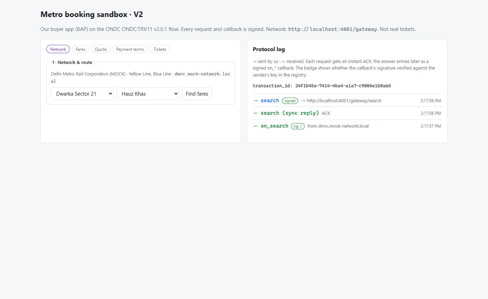
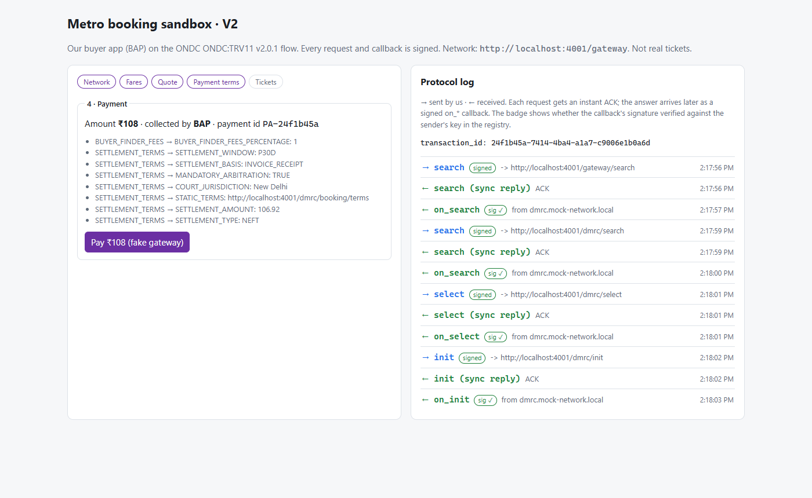
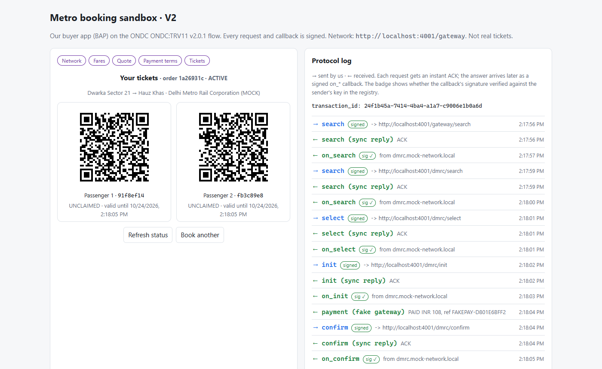
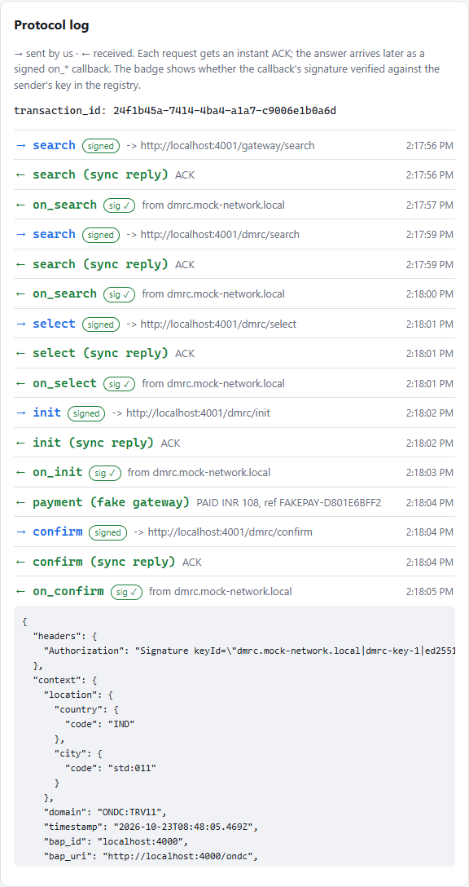

# Demo Metro Booking (ONDC / DMRC sandbox)

A local, self-contained demo of how a buyer app books **Delhi Metro (DMRC) QR tickets** over the
**ONDC network**, using the **TRV11 v2.0.1** spec (unreserved metro and bus tickets). DMRC and the ONDC network are
**mocked**. The buyer-side code is spec-shaped and signs every message the way ONDC requires.

> For background (ONDC roles, signing, registry onboarding and going live), see [`docs/ONDC-GUIDE.md`](docs/ONDC-GUIDE.md).

## Key idea

There is no DMRC API key. A buyer app (**BAP**) joins ONDC, and DMRC is already a seller (**BPP**) on it. They
exchange **signed, asynchronous** messages:

```
search → select → init → (buyer takes payment) → confirm → status
```

Each request gets an instant `ACK`. The actual answer comes later as a separate callback (`on_search`,
`on_select`, …) **from the seller to the buyer's server**.

## Components

```
 web (:5173) ──/metro──▶ bap (:4000) ──signed search──▶ gateway ──▶ sellers (DMRC, NMRC)
                            ▲  │                                         │
                            │  └── signed select/init/confirm/status ──▶ seller
                            └──────────── signed on_* callbacks ◀────────┘
                  bap ◀── key lookup ──▶ registry           (gateway, registry, sellers: bpp-mock on :4001)
```

| Folder | Role | Real-world equivalent |
| --- | --- | --- |
| [`web/`](web/) | **Client.** One-page React (Vite) UI for the booking flow, plus a live protocol log of every message | The rider's app screens |
| [`bap/`](bap/) | **Buyer backend (ours).** Builds and signs ONDC requests, verifies callbacks, tracks bookings, handles registry onboarding | Our production backend module |
| [`bpp-mock/`](bpp-mock/) | **Mock ONDC network.** Registry, gateway, and fake sellers `dmrc` (Yellow and Blue lines) and `nmrc` (Aqua line) | ONDC + DMRC's systems (not ours) |
| [`docs/`](docs/) | Concept guide and screenshots | — |

**Inside `bap/src/`**

| File | Purpose |
| --- | --- |
| `config.ts` | All network settings, read from env |
| `ondc/payloads.ts`, `context.ts` | Build the TRV11 request messages |
| `ondc/signing.ts`, `registry.ts` | Sign outgoing requests; verify incoming ones against the sender's key from the registry |
| `ondc/client.ts` | Send requests: to the gateway for `search`, straight to the seller for everything else |
| `ondc/callbacks.ts`, `parse.ts` | Receive `on_*` callbacks, match them to a booking, extract stations, fares, quotes and tickets |
| `ondc/onboarding.ts`, `scripts/` | Key generation, registry `/subscribe`, site verification, signature self-check |
| `app.routes.ts`, `store.ts` | `/metro/*` API used by `web`; in-memory booking store |

**Real vs. mocked:** message formats, signing and verification are real. The network, DMRC, the payment
gateway and storage (in-memory) are mocked.

## Run it

Requires Node.js 20+ and pnpm.

```bash
pnpm install
pnpm keys               # generate signing + encryption keys into bap/.env.keys (gitignored, never share)
pnpm dev                # starts bpp-mock :4001, bap :4000, web :5173
pnpm subscribe --send   # once, in a second terminal: register with the mock registry
```

Open **http://localhost:5173**. Try **Dwarka Sector 21 → Hauz Khas** (a cross-line trip that changes at Rajiv Chowk).

To have two sellers answer the search (PowerShell): `$env:MOCK_SELLERS="dmrc,nmrc"; pnpm dev`

## Screenshots

**1. Network & route.** The `search` goes through the gateway, and DMRC answers with its lines and stations.


**2. Payment terms.** `on_init` returns the amount, who collects it, and the settlement terms.


**3. Tickets.** After the fake payment, `confirm` → `on_confirm` returns one QR per passenger.


**4. Protocol log.** `→` marks our signed requests. `←` marks callbacks, with **sig ✓** when the signature verified.
Click a row to see the full JSON.


## Commands

| Command | Purpose |
| --- | --- |
| `pnpm dev` | Run all three components |
| `pnpm keys [--force]` | Generate the BAP's keys |
| `pnpm subscribe [--send]` | Print, or send, the registry registration payload |
| `pnpm check:signing` | Cross-check our signatures with an independent implementation |
| `pnpm typecheck` | Type-check all packages |

## Known limitations

- There is no `cancel`, `update` or `support` flow yet, and no refund path when payment succeeds but the ticket fails.
- The mock registry stores registrations in `bpp-mock/.data/`. If that folder is deleted or keys are regenerated,
  run `pnpm subscribe --send` again.
- The QR codes are **not** valid tickets. Real QRs are issued only by DMRC.
